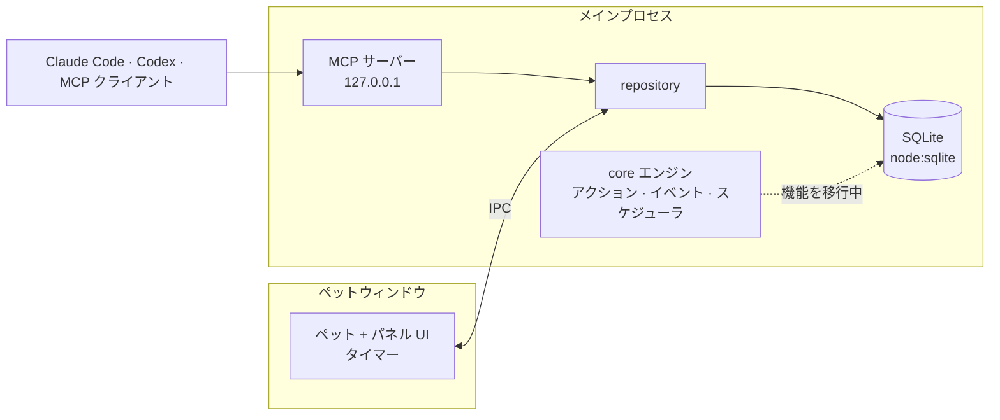

# petnudge

**デスクトップに住むピクセルペットが、ToDo・ポモドーロ・コーディングエージェントまで面倒を見てくれます。**

[](https://github.com/LeeSwallow/petnudge/actions/workflows/ci.yml)
[](https://github.com/LeeSwallow/petnudge/releases)
[](LICENSE)


[English](README.md) · [한국어](README.ko.md) · 日本語

[インストール](#インストール) · [できること](#できること) · [コーディングエージェントと一緒に](#コーディングエージェントと一緒に) · [キャラクター](#キャラクター) · [構成](#構成) · [コントリビュート](#コントリビュート) · [ロードマップ](ROADMAP.md)


ToDoアプリは、自分で開かないと何も教えてくれません。ペットは自分から声を
かけてきます。petnudgeは、デスクトップの上に立つ小さなピクセルキャラクター
です。常に最前面にいますが、作業の邪魔はしません。次にやることを見せ、
ポモドーロを回し、時間になると吹き出しでそっと知らせます。右クリックすると、
ToDo、タイマー、今週の記録が入ったパネルが開きます。

コーディングエージェントも同じペットを使えます。Claude CodeやCodexなど、
MCPに対応したツールがToDoを追加し、タイマーを始め、テストが通ったらペットを
喜ばせます。データは自分のパソコンに保存されます。


> **ステータス：リリース準備中。** 作者の机では毎日使っていて、最初の公開
> ビルド（v0.2.0）を準備しています。macOS・Windows・Linuxのインストーラー、
> スヌーズできるリマインダー、仮の名前からの改名が入ります。ファイル形式や
> 設定はまだ変わる可能性があります。ペットにこうしてほしかった、という声を
> [デザインフィードバック](https://github.com/LeeSwallow/petnudge/issues/new?template=design_feedback.yml)で
> 教えてください。計画は[ROADMAP.md](ROADMAP.md)、方針は[VISION.md](VISION.md)にあります。

## インストール

リリースごとのインストーラーは[Releasesページ](https://github.com/LeeSwallow/petnudge/releases)にあります。

| システム | ファイル |
| --- | --- |
| macOS（Apple silicon、Intel） | `petnudge-<version>-arm64.dmg`、`petnudge-<version>-x64.dmg` |
| Windows 10、11 | `petnudge-Setup-<version>.exe` |
| Linux | `petnudge-<version>.AppImage` |

macOS版はまだ公証（notarization）を受けていません。初回は右クリック →
**開く**で起動するか、`xattr -dr com.apple.quarantine /Applications/petnudge.app`を
実行してください。

### ソースから

Node.js 22.16以降が必要です（組み込みの`node:sqlite`を使います）。

```sh
git clone https://github.com/LeeSwallow/petnudge
cd petnudge
npm install
npm start            # ビルドして起動
npm test             # 200以上のテスト：ドメイン、DB、エンジン、MCP
npm run dist:mac     # dist:win、dist:linuxも。release/にインストーラーを作成
```

ペットが画面の外に消えたら、**⌘/Ctrl + Alt + P**で呼び戻せます。

## できること

| | |
| --- | --- |
| **ToDo** | 項目ごとにポモドーロの見積もり数を書く短いリストです。ペットが次のタスクと終わるおおよその時刻を教えます。 |
| **ポモドーロ** | 集中、短い休憩、長い休憩、1日の目標、セッション後のひとこと振り返り（任意）。ペットのポーズがタイマーに合わせて変わります。 |
| **ダッシュボード** | 今日の記録、連続日数、直近7日間、集中しやすい時間帯を、ローカルのSQLiteから表示します。 |
| **メモ** | ToDoの横にピン留めできるMarkdownメモです。 |
| **音楽**（任意） | 手持ちの音楽ファイルを集中用・休憩用のプレイリストにします。macOSではタイマーに合わせてSpotifyやApple Musicを一時停止・再開することもできます。この連携は自分でオンにするまでオフです。 |
| **チャット**（任意） | ログイン済みのClaude CodeやCodex、APIキー（Anthropic、OpenAI、OpenRouter）、ローカルモデルのいずれかでペットと話せます。エージェントと同じツールを使います。 |
| **キャラクターとMod** | キャラクター、服、色を変えられます。ModはJSONファイル1つで小さなリアクションを追加します。 |

ペットを**右クリック**（またはShift+F10）するとパネルが開き、**左クリック**で
反応し、**ドラッグ**で動かせます。ペットは少し歩き回り、カーソルのほうを見て、
まばたきし、頭や手をタップすると反応します。

データはローカルのSQLiteファイルに保存されます。パソコンの外に出るのは
チャットだけです。チャットを使うと、メッセージ、ペットの状況（タイマー、ToDoの
件数、再生中の曲）、許可したツールの実行結果が、選んだプロバイダーに送られます。

## コーディングエージェントと一緒に

petnudgeの起動中は、MCP（Model Context Protocol）サーバーが動きます。自分の
パソコンからしか接続できず、トークンが必要です。アドレスは通常
`http://127.0.0.1:47615/mcp`で、そのポートが使用中なら別の空きポートを使います。
**設定 → AI接続**に正確なアドレスとトークンが表示され、Claude Code用のコマンドと
Cursor用の設定をそのままコピーできます。

```sh
claude mcp add --transport http petnudge <設定に表示されたアドレス> \
  --header "Authorization: Bearer <設定に表示されたトークン>"
```

あとはエージェントに「このレビューで出たフォローアップ3件をToDoに入れて」
「25分の集中を始めて」「ビルドが通ったらペットにお祝いさせて」のように
頼むだけです。使えるツールは次のとおりです。

| 分類 | ツール |
| --- | --- |
| ToDo | `list_todos`、`add_todo`、`update_todo`、`complete_todo`、`delete_todo`、`clear_completed_todos` |
| タイマー・統計 | `get_timer`、`control_timer`、`get_stats` |
| メモ | `list_notes`、`add_note`、`update_note`、`delete_note` |
| ペット | `pet_express`、`list_characters`、`switch_character`、`list_mods`、`toggle_mod` |
| その他 | `get_now`、`get_settings`、`update_settings`、`list_playlists`、`control_music`、チャットセッション |

エージェントの作業中（考え中、承認待ち、失敗、完了）にペットが反応する
hook付きのClaude Code・Codexプラグインは[ロードマップ](ROADMAP.md)にあります。

## キャラクター


キャラクターは3人入っています。どれも平面のスプライトシートではなく、
レイヤー式の着せ替え人形です。髪、顔、体、腕、服がそれぞれ別のレイヤーに
なっていて、フレームごとに重ねて描きます。そのため表情だけを変えたり、
カーソルのほうへ顔を向けたり、服や色を着せ替えたりできます。

| コンセプトアート | 表情 |
| --- | --- |
|  |  |

キャラクターは[Aseprite](https://www.aseprite.org/)か
[Pixelorama](https://pixelorama.org/)で、パーツごとに1レイヤーずつ描き、
パックファイルにパーツの動き方を書きます。ファイルを保存すると、起動中の
ペットにすぐ反映されます。詳しくは[キャラクターガイド](assets/characters/README.md)（現在は韓国語のみ）をご覧ください。

**Petdex・Codexペット。** [Petdex](https://petdex.dev)とCodexのペットは、
192×208のフレームを並べた平面シートです。9つのアニメーションを収めた8×9か、
16方向の視線を加えたCodex v2用の8×11です。これらのペットを平面ペットとして
動かすことと、petnudgeのキャラクターをCodex v2シートとして書き出すことを
計画しています。どちらもまだ使えません。[ロードマップ](ROADMAP.md)をご覧ください。

## 構成

TypeScriptで書かれたElectronアプリです。ペットとパネルは、透明で常に最前面に
表示されるウィンドウ1つで、現在はタイマーもこのウィンドウで動いています。
メインプロセスにはデータベースとMCPサーバー、そして新しいcoreエンジンがあります。
機能をToDoから順にエンジンへ移しているところで、タイマーとこれから入る
リマインダーも一緒に移します。そうすればウィンドウの状態に関係なく動き続けます。



| フォルダ | 中身 |
| --- | --- |
| `src/domain/` | 純粋なルール：ポモドーロ、進捗、ペットの状態、アイコン。入出力はありません。 |
| `src/core/` | エンジン（Effect）：アクションを順番に処理し、コミット後にイベントを送り、次のジョブまで眠るスケジューラを持ちます。 |
| `src/infra/` | Electron・システムのアダプター：電源イベント、ランタイム。 |
| `src/main/` | ウィンドウ、データベース、MCP、キャラクター、Mod、チャット。 |
| `src/renderer/` | ペット、パネルとそのモジュール。 |
| `assets/characters/`、`assets/mods/` | 標準のキャラクターとMod。 |
| `scripts/` | キャラクターの書き出し、デモ用スクリーンショット。 |

新しいレイヤーは下方向にしかimportしません（`ui`/`infra` → `app` → `core` →
`domain`）。違反すると`src/architecture.test.ts`が失敗します。`src/main`、
`src/renderer`、`src/preload`、`src/shared`は以前のコードで、モジュールごとに
新しいレイヤーへ移している途中です。詳しくは[docs/architecture.md](docs/architecture.md)をご覧ください。

## コントリビュート

いま一番ありがたいのは、1日使ってみて、何を期待したかを教えてもらうことです。
ほかにも次の方法があります。

- [バグ報告](https://github.com/LeeSwallow/petnudge/issues/new?template=bug.yml)
- [機能リクエスト](https://github.com/LeeSwallow/petnudge/issues/new?template=feature.yml)
- [新しいキャラクター](https://github.com/LeeSwallow/petnudge/issues/new?template=character.yml)：自分で描き、他の人も使えるライセンスのもの
- アプリの翻訳（現在は韓国語、次は英語と日本語）

セットアップとルールは[CONTRIBUTING.md](CONTRIBUTING.md)にあります。
petnudgeが役に立ったら、⭐を押してもらえると他の人が見つけやすくなります。

## ライセンス

コードと標準キャラクターは[MIT](LICENSE)です。同梱のフォントとライブラリは
それぞれのライセンスに従います：[THIRD_PARTY_NOTICES.md](THIRD_PARTY_NOTICES.md)。
