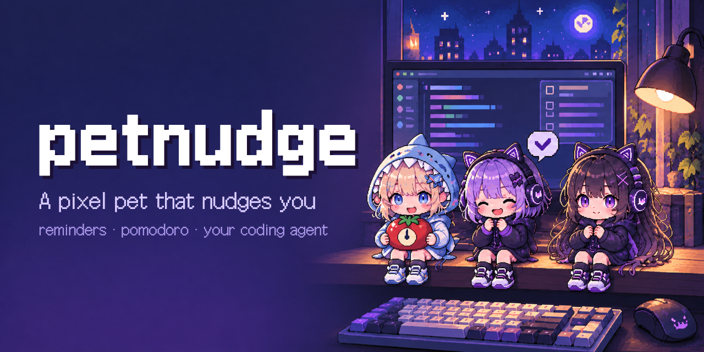
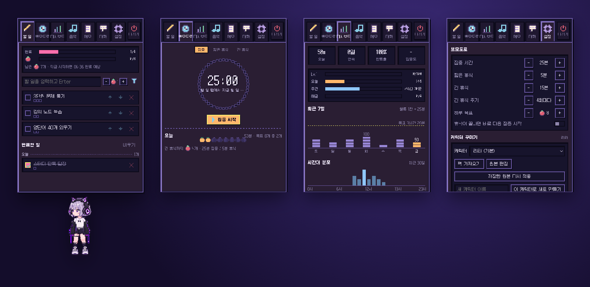
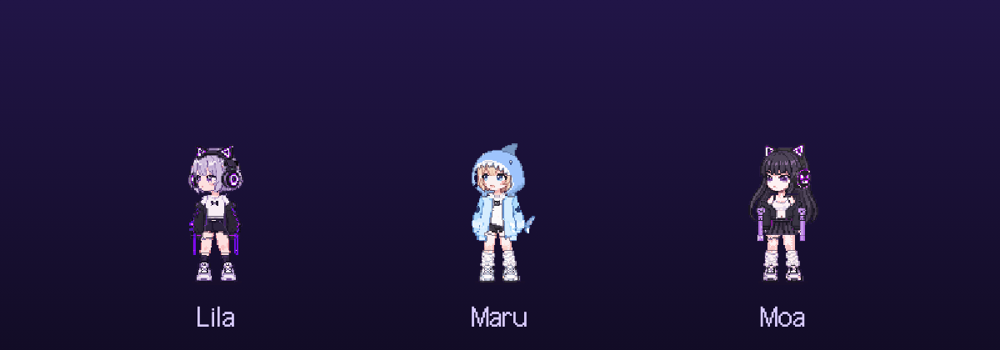
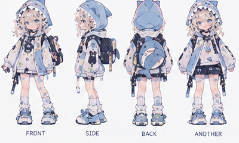
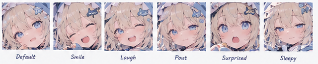
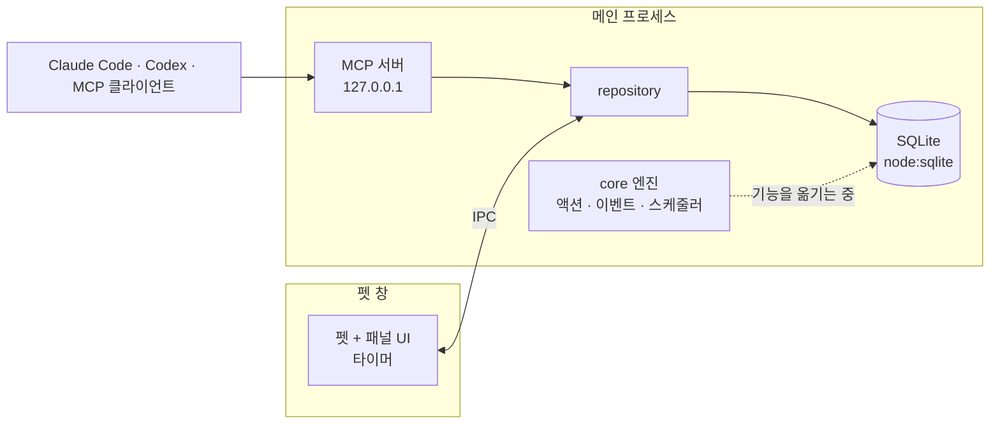

# petnudge

**바탕화면에 사는 픽셀 펫이 할 일, 뽀모도로, 코딩 에이전트까지 챙겨 줍니다.**

[](https://github.com/LeeSwallow/petnudge/actions/workflows/ci.yml)
[](https://github.com/LeeSwallow/petnudge/releases)
[](LICENSE)


[English](README.md) · 한국어 · [日本語](README.ja.md)

[설치](#설치) · [할 수 있는 일](#할-수-있는-일) · [코딩 에이전트와 함께](#코딩-에이전트와-함께) · [캐릭터](#캐릭터) · [구조](#구조) · [기여하기](#기여하기) · [로드맵](ROADMAP.md)



할 일 앱은 내가 열어야 보입니다. 펫은 먼저 말을 겁니다. petnudge는
바탕화면 위에 서 있는 작은 픽셀 캐릭터입니다. 항상 위에 떠 있지만 작업을
가리지 않습니다. 다음에 할 일을 보여 주고, 뽀모도로를 돌리고, 때가 되면
말풍선으로 톡 건드려 줍니다. 우클릭하면 할 일, 타이머, 이번 주 기록이 담긴
패널이 열립니다.

코딩 에이전트도 같은 펫을 씁니다. Claude Code, Codex 등 MCP를 지원하는
도구가 할 일을 추가하고, 타이머를 시작하고, 테스트가 통과하면 펫을 기뻐하게
만듭니다. 데이터는 내 컴퓨터에 저장됩니다.



> **상태: 출시 준비 중.** 제 책상에서는 매일 쓰고 있고, 첫 공개 빌드(v0.2.0)를
> 준비하고 있습니다. macOS·Windows·Linux 설치 파일, 다시 알림이 되는 리마인더,
> 가제에서 새 이름으로 옮기는 작업이 들어갑니다. 파일 형식과 설정은 아직 바뀔 수
> 있습니다. 펫이 이렇게 해 주길 기대했다는 이야기를
> [디자인 피드백 이슈](https://github.com/LeeSwallow/petnudge/issues/new?template=design_feedback.yml)로
> 남겨 주세요. 계획은 [ROADMAP.md](ROADMAP.md), 원칙은 [VISION.md](VISION.md)에 있습니다.

## 설치

릴리스마다 [Releases 페이지](https://github.com/LeeSwallow/petnudge/releases)에
설치 파일을 올립니다.

| 시스템 | 파일 |
| --- | --- |
| macOS (Apple silicon, Intel) | `petnudge-<version>-arm64.dmg`, `petnudge-<version>-x64.dmg` |
| Windows 10, 11 | `petnudge-Setup-<version>.exe` |
| Linux | `petnudge-<version>.AppImage` |

macOS 빌드는 아직 공증(notarization)을 받지 않았습니다. 처음 한 번은
우클릭 → **열기**로 열거나 `xattr -dr com.apple.quarantine /Applications/petnudge.app`을
실행해 주세요.

### 소스에서 실행

Node.js 22.16 이상이 필요합니다(내장 `node:sqlite`를 씁니다).

```sh
git clone https://github.com/LeeSwallow/petnudge
cd petnudge
npm install
npm start            # 빌드하고 실행
npm test             # 테스트 200여 개: 도메인, DB, 엔진, MCP
npm run dist:mac     # dist:win, dist:linux도 있음. release/에 설치 파일 생성
```

펫이 화면 밖으로 사라졌다면 **⌘/Ctrl + Alt + P**로 불러올 수 있습니다.

## 할 수 있는 일

| | |
| --- | --- |
| **할 일** | 항목마다 뽀모도로 예상 개수를 적는 짧은 목록입니다. 펫이 다음 할 일과 대략 끝나는 시각을 알려 줍니다. |
| **뽀모도로** | 집중, 짧은 휴식, 긴 휴식, 하루 목표, 세션 뒤 한 줄 회고(선택)를 지원합니다. 펫의 자세가 타이머를 따라 바뀝니다. |
| **대시보드** | 오늘 기록, 연속 일수, 최근 7일, 집중이 잘 되는 시간대를 로컬 SQLite에서 보여 줍니다. |
| **메모** | 할 일 옆에 고정해 두는 Markdown 메모입니다. |
| **음악** (선택) | 내 음악 파일을 집중용·휴식용 플레이리스트로 씁니다. macOS에서는 타이머에 맞춰 Spotify와 Apple Music을 멈추거나 다시 틀 수도 있습니다. 이 연동은 직접 켜기 전까지 꺼져 있습니다. |
| **대화** (선택) | 로그인한 Claude Code나 Codex, API 키(Anthropic, OpenAI, OpenRouter), 로컬 모델 중 하나로 펫과 대화합니다. 에이전트와 같은 도구를 씁니다. |
| **캐릭터와 모드** | 캐릭터, 옷, 색을 바꿀 수 있습니다. 모드는 JSON 파일 하나로 작은 반응을 더합니다. |

펫을 **우클릭**(또는 Shift+F10)하면 패널이 열리고, **좌클릭**하면 반응하고,
**드래그**하면 옮길 수 있습니다. 펫은 조금씩 걸어 다니고, 커서 쪽을 바라보고,
눈을 깜빡이고, 머리나 손을 누르면 반응합니다.

데이터는 로컬 SQLite 파일에 저장됩니다. 내 컴퓨터 밖으로 나가는 것은 대화
기능뿐입니다. 대화를 쓰면 내 메시지, 펫의 상황 정보(타이머, 할 일 개수, 재생
중인 곡), 허용한 도구의 실행 결과가 내가 고른 제공자에게 전송됩니다.

## 코딩 에이전트와 함께

petnudge가 실행되는 동안 MCP(Model Context Protocol) 서버가 열립니다. 내
컴퓨터에서만 접속할 수 있고 토큰이 필요합니다. 주소는 보통
`http://127.0.0.1:47615/mcp`이고, 그 포트를 이미 쓰고 있으면 다른 빈 포트를
씁니다. **설정 → AI 연결**에 정확한 주소와 토큰이 나오고, Claude Code용 명령과
Cursor용 설정을 바로 복사할 수 있습니다.

```sh
claude mcp add --transport http petnudge <설정에 나온 주소> \
  --header "Authorization: Bearer <설정에 나온 토큰>"
```

그다음 에이전트에게 "이번 리뷰에서 나온 후속 작업 세 개를 할 일로 넣어 줘",
"25분 집중 시작해 줘", "빌드 통과하면 펫이 축하하게 해 줘"처럼 부탁하면 됩니다.
쓸 수 있는 도구는 다음과 같습니다.

| 분류 | 도구 |
| --- | --- |
| 할 일 | `list_todos`, `add_todo`, `update_todo`, `complete_todo`, `delete_todo`, `clear_completed_todos` |
| 타이머·통계 | `get_timer`, `control_timer`, `get_stats` |
| 메모 | `list_notes`, `add_note`, `update_note`, `delete_note` |
| 펫 | `pet_express`, `list_characters`, `switch_character`, `list_mods`, `toggle_mod` |
| 기타 | `get_now`, `get_settings`, `update_settings`, `list_playlists`, `control_music`, 대화 세션 |

에이전트가 일하는 동안(생각 중, 승인 대기, 실패, 완료) 펫이 반응하도록 hook을
넣은 Claude Code·Codex 플러그인은 [로드맵](ROADMAP.md)에 있습니다.

## 캐릭터



캐릭터 셋이 기본으로 들어 있습니다. 각 캐릭터는 평면 스프라이트 시트가 아니라
레이어 종이인형입니다. 머리카락, 얼굴, 몸, 팔, 옷이 각각 레이어로 나뉘어
있고 프레임마다 합쳐서 그립니다. 그래서 표정만 따로 바꾸고, 커서 쪽으로
고개를 돌리고, 옷과 색을 갈아입힐 수 있습니다.

| 컨셉아트 | 표정 |
| --- | --- |
|  |  |

캐릭터는 [Aseprite](https://www.aseprite.org/)나
[Pixelorama](https://pixelorama.org/)에서 부위마다 레이어 하나씩 그리고,
팩 파일에 부위가 움직이는 방식을 적습니다. 파일을 저장하면 실행 중인 펫이
바로 바뀝니다. 자세한 내용은 [캐릭터 가이드](assets/characters/README.md)에 있습니다.

**Petdex·Codex 펫.** [Petdex](https://petdex.dev)와 Codex 펫은 192×208 프레임을
늘어놓은 평면 시트입니다. 애니메이션 9개를 담은 8×9 시트이거나, 시선 방향 16개를
더한 Codex v2용 8×11 시트입니다. 이 펫들을 평면 펫으로 재생하는 것과 petnudge
캐릭터를 Codex v2 시트로 내보내는 것을 계획하고 있습니다. 둘 다 아직은 되지
않습니다. [로드맵](ROADMAP.md)을 참고해 주세요.

## 구조

TypeScript로 만든 Electron 앱입니다. 펫과 패널은 투명하고 항상 위에 뜨는 창
하나이고, 지금은 이 창에서 타이머도 돌아갑니다. 메인 프로세스에는 데이터베이스와
MCP 서버, 그리고 새 core 엔진이 있습니다. 기능을 할 일부터 하나씩 엔진으로 옮기는
중이고, 타이머와 앞으로 생길 리마인더도 함께 옮깁니다. 그러면 창이 어떤 상태든
계속 돌아갑니다.



| 폴더 | 내용 |
| --- | --- |
| `src/domain/` | 순수 규칙: 뽀모도로, 진행도, 펫 상태, 아이콘. 입출력이 없습니다. |
| `src/core/` | 엔진(Effect): 액션을 차례로 처리하고, 커밋 뒤에 이벤트를 보내고, 다음 작업까지 잠드는 스케줄러를 둡니다. |
| `src/infra/` | Electron·시스템 어댑터: 전원 이벤트, 런타임. |
| `src/main/` | 창, 데이터베이스, MCP, 캐릭터, 모드, 대화. |
| `src/renderer/` | 펫, 패널과 패널 모듈. |
| `assets/characters/`, `assets/mods/` | 기본 캐릭터와 모드. |
| `scripts/` | 캐릭터 내보내기, 데모 스크린샷. |

새 레이어는 아래 방향으로만 import합니다(`ui`/`infra` → `app` → `core` →
`domain`). 어기면 `src/architecture.test.ts`가 실패합니다. `src/main`,
`src/renderer`, `src/preload`, `src/shared`는 이전 코드이고, 모듈 단위로 새
레이어에 옮기는 중입니다. 자세한 내용은 [docs/architecture.md](docs/architecture.md)에 있습니다.

## 기여하기

지금 가장 도움이 되는 건 하루 써 보고 무엇을 기대했는지 알려 주시는 것입니다.
그 밖에는 이런 방법이 있습니다.

- [버그 제보](https://github.com/LeeSwallow/petnudge/issues/new?template=bug.yml)
- [기능 제안](https://github.com/LeeSwallow/petnudge/issues/new?template=feature.yml)
- [새 캐릭터](https://github.com/LeeSwallow/petnudge/issues/new?template=character.yml): 직접 그렸고, 다른 사람이 써도 되는 라이선스인 캐릭터
- 앱 번역 (지금은 한국어, 다음은 영어와 일본어)

설정 방법과 규칙은 [CONTRIBUTING.md](CONTRIBUTING.md)에 있습니다. petnudge가
도움이 됐다면 ⭐를 눌러 주세요. 다른 사람이 찾는 데 큰 힘이 됩니다.

## 라이선스

코드와 기본 캐릭터는 [MIT](LICENSE)입니다. 함께 들어 있는 폰트와 라이브러리는
각자의 라이선스를 따릅니다: [THIRD_PARTY_NOTICES.md](THIRD_PARTY_NOTICES.md).
