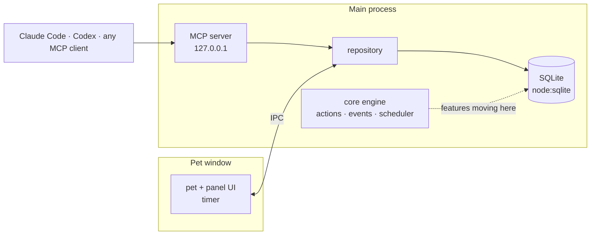

# petnudge

**A pixel pet that lives on your desktop and nudges you: todos, pomodoro, and your coding agent.**

[](https://github.com/LeeSwallow/petnudge/actions/workflows/ci.yml)
[](https://github.com/LeeSwallow/petnudge/releases)
[](LICENSE)


English · [한국어](README.ko.md) · [日本語](README.ja.md)

[Install](#install) · [What it does](#what-it-does) · [Your coding agent](#your-coding-agent) · [Characters](#characters) · [How it is built](#how-it-is-built) · [Contributing](#contributing) · [Roadmap](ROADMAP.md)


A todo app waits for you to open it. A pet does not. petnudge is a small
pixel character that stands on your desktop, always on top and out of the
way. It shows what to do next, runs your pomodoro, and taps you on the
shoulder with a speech bubble when it is time. Right-click it and a panel
opens with your todos, the timer and how your week went.

Your coding agent can use the same pet. Claude Code, Codex or any MCP
client adds a todo, starts the timer or makes the pet cheer when the tests
pass. Your data stays on your machine.


> **Status: pre-release.** petnudge works every day on my desk, and the
> first public build (v0.2.0) is being prepared: installers for macOS,
> Windows and Linux, reminders with snooze, and the rename from its working
> title. File formats and settings may still change. Tell me what you
> expected the pet to do in a
> [design feedback issue](https://github.com/LeeSwallow/petnudge/issues/new?template=design_feedback.yml).
> The plan is in [ROADMAP.md](ROADMAP.md), the principles in [VISION.md](VISION.md).

## Install

Installers for each release are on the
[Releases page](https://github.com/LeeSwallow/petnudge/releases):

| System | File |
| --- | --- |
| macOS (Apple silicon, Intel) | `petnudge-<version>-arm64.dmg`, `petnudge-<version>-x64.dmg` |
| Windows 10, 11 | `petnudge-Setup-<version>.exe` |
| Linux | `petnudge-<version>.AppImage` |

The macOS build is not notarized yet. The first time, open it with
right-click → **Open**, or run `xattr -dr com.apple.quarantine /Applications/petnudge.app`.

### From source

You need Node.js 22.16 or later (petnudge uses the built-in `node:sqlite`).

```sh
git clone https://github.com/LeeSwallow/petnudge
cd petnudge
npm install
npm start            # build and run
npm test             # 200+ tests: domain, database, engine, MCP
npm run dist:mac     # or dist:win, dist:linux: an installer in release/
```

Lost the pet off screen? **⌘/Ctrl + Alt + P** brings it back.

## What it does

| | |
| --- | --- |
| **Todos** | A short list with a pomodoro estimate per item. The pet tells you what is next and roughly when you will be done. |
| **Pomodoro** | Focus, short and long breaks, a daily goal, an optional one-line review after each session. The pet's pose follows the timer. |
| **Dashboard** | Today, the streak, the last 7 days and the hours you focus best, from a local SQLite database. |
| **Notes** | Pinned Markdown notes next to your todos. |
| **Music** (optional) | Your own music files as focus and break playlists. On macOS it can also pause and resume Spotify or Apple Music with the timer; that sync is off until you turn it on. |
| **Chat** (optional) | Talk to the pet through your own Claude Code or Codex login, an API key (Anthropic, OpenAI, OpenRouter) or a local model. It can use the same tools your agent does. |
| **Characters and mods** | Swap characters, outfits and colors; mods add small reactions in plain JSON. |

**Right-click** the pet (or Shift+F10) to open the panel, **left-click** to
play with it, **drag** to move it. It walks a little, looks toward your
cursor, blinks, and reacts when you tap its head or hand.

Data is a local SQLite file. Chat is the one thing that leaves your machine:
when you use it, your messages, the pet's context (timer, todo count, the
song playing) and the results of the tools you allow go to the provider you
picked.

## Your coding agent

While petnudge runs, it serves MCP (Model Context Protocol) on your machine
only, behind a token: `http://127.0.0.1:47615/mcp`, or another free port when
that one is taken. **Settings → AI connection** shows the exact URL and
token and copies a ready command for Claude Code or a config for Cursor:

```sh
claude mcp add --transport http petnudge <URL from Settings> \
  --header "Authorization: Bearer <token from Settings>"
```

Then ask your agent things like "add the three follow-ups from this review
as todos", "start a 25-minute focus session" or "make the pet celebrate
when the build is green". The tools:

| Group | Tools |
| --- | --- |
| todos | `list_todos`, `add_todo`, `update_todo`, `complete_todo`, `delete_todo`, `clear_completed_todos` |
| timer and stats | `get_timer`, `control_timer`, `get_stats` |
| notes | `list_notes`, `add_note`, `update_note`, `delete_note` |
| pet | `pet_express`, `list_characters`, `switch_character`, `list_mods`, `toggle_mod` |
| other | `get_now`, `get_settings`, `update_settings`, `list_playlists`, `control_music`, chat sessions |

A Claude Code and Codex plugin, with hooks so the pet reacts while the agent
works (thinking, waiting for your approval, failed, done), is on the
[roadmap](ROADMAP.md).

## Characters


Three characters come built in. Each one is a layered paper doll, not a
flat sprite sheet: separate layers for hair, face, body, arms and outfit,
put together every frame. That is what lets a character change expression
on its own, turn its head toward the cursor, and swap outfits and colors.

| Concept art | Expressions |
| --- | --- |
|  |  |

Characters are drawn in [Aseprite](https://www.aseprite.org/) or
[Pixelorama](https://pixelorama.org/), one layer per body part, and a pack
file says how the parts move. Saving the file updates the running pet.
See [the character guide](assets/characters/README.md) (Korean for now).

**Petdex and Codex pets.** [Petdex](https://petdex.dev) and Codex pets are
flat sheets of 192×208 frames: 8×9 with nine animations, or 8×11 for Codex
v2 pets, which add sixteen look directions. Two things are planned: playing
those pets as flat pets, and exporting petnudge characters to Codex v2
sheets. Neither works yet; see the [roadmap](ROADMAP.md).

## How it is built

An Electron app in TypeScript. The pet and its panel are one transparent,
always-on-top window, which today also runs the timer. The main process
holds the database and the MCP server, and a new core engine that features
are moving onto one at a time, todos first; the timer and the coming
reminders move with them, so they keep running whatever the window does.



| Folder | What is in it |
| --- | --- |
| `src/domain/` | Pure rules: pomodoro, progress, pet state, icons. No I/O. |
| `src/core/` | The engine (Effect): serial actions, events after commit, a scheduler that sleeps until the next job. |
| `src/infra/` | Electron and system adapters: power events, the runtime. |
| `src/main/` | Windows, the database, MCP, characters, mods, chat. |
| `src/renderer/` | The pet, the panel and its modules. |
| `assets/characters/`, `assets/mods/` | Built-in characters and mods. |
| `scripts/` | Character export, demo screenshots. |

The new layers import only downward (`ui`/`infra` → `app` → `core` →
`domain`) and `src/architecture.test.ts` fails otherwise. `src/main`,
`src/renderer`, `src/preload` and `src/shared` are the older code, moving
into those layers module by module. More in [docs/architecture.md](docs/architecture.md).

## Contributing

The most useful thing right now is to use it for a day and say what you
expected. Then:

- a [bug report](https://github.com/LeeSwallow/petnudge/issues/new?template=bug.yml),
- a [feature request](https://github.com/LeeSwallow/petnudge/issues/new?template=feature.yml),
- a [new character](https://github.com/LeeSwallow/petnudge/issues/new?template=character.yml): drawn by you, under a license that lets others use it,
- a translation of the app (Korean today; English and Japanese next).

[CONTRIBUTING.md](CONTRIBUTING.md) has the setup and the rules. If petnudge
keeps you on track, a ⭐ helps other people find it.

## License

[MIT](LICENSE) for the code and the built-in characters. Bundled fonts and
libraries keep their own licenses: [THIRD_PARTY_NOTICES.md](THIRD_PARTY_NOTICES.md).
