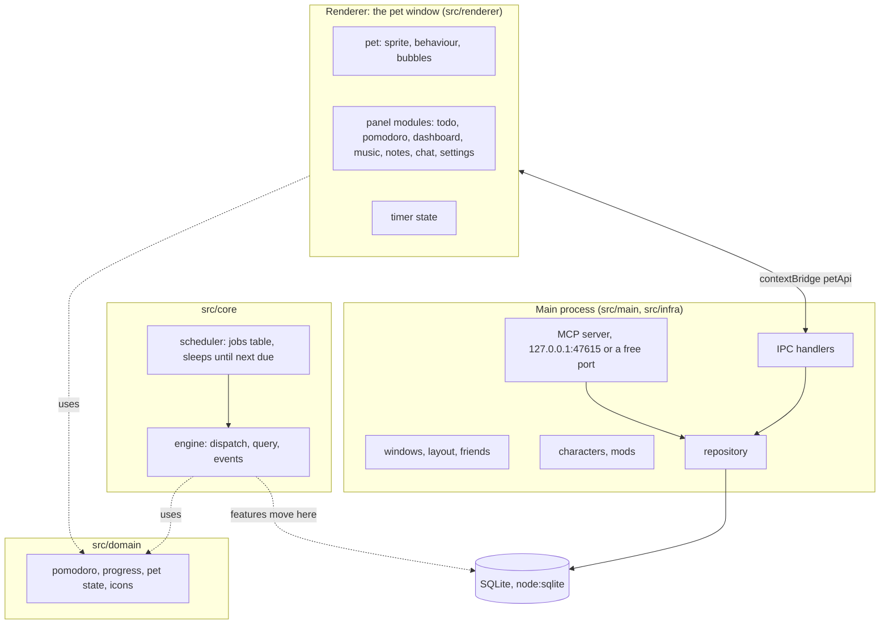

# Architecture

petnudge is one Electron app. The main process owns the database, the MCP
server and the core engine; the renderer draws the pet and the panel, runs
the timer for now, and asks the main process for every change to the data.

Today the renderer runs the timer and IPC and MCP call the repository
directly. The engine is running (started from `src/infra/runtime.ts`) with no
feature modules yet; todos move onto it first, then the timer and reminders,
so that they keep working whatever the window does.

## Layers

Dependencies point down: `ui`/`infra` → `app` → `core` → `domain`.

| Layer | May import | Holds |
| --- | --- | --- |
| `src/domain` | `domain` only, no packages | pure functions and types: pomodoro math, progress, pet state, pixel icons |
| `src/core` | `domain`, `effect` | the engine, the scheduler, typed errors, the module registry, the DB service |
| `src/app` | `core`, `domain`, `effect` | feature modules (actions, queries, jobs), as they move out of the older code |
| `src/infra` | everything below, Electron, `node:` | the runtime that starts the engine, power and lock events, adapters |
| `src/ui` | `domain` | the renderer, as it moves out of the older code |

`src/architecture.test.ts` reads every import in those folders and fails on
a rule broken. The older folders, `src/main` (windows, repository, MCP,
characters, mods, chat, backup), `src/renderer` (the pet and the panel),
`src/preload` and `src/shared`, are not checked yet; they move into the
layers module by module, todos first.

## The engine

- **Actions** run one at a time, each inside a database transaction. A failed
  action rolls back and returns a typed error; nothing half-written stays.
- **Events** are sent only after the transaction commits, so a listener never
  sees a change that was rolled back.
- **The scheduler** keeps due jobs in a `jobs` table. Its loop sleeps until the
  next job (at most an hour) or until it is woken: by a new job, by the system
  resuming from sleep, by the screen unlocking. A failed cycle is retried; a
  corrupt row is marked done instead of blocking the queue.
- **Handlers never wait on the outside world.** Network calls (chat, music
  detection) happen outside actions and come back as new actions.

## Characters

A character is a folder: the source art (`.aseprite` or `.pxo`, one layer per
body part), a pack file (`<id>.pack.json`: draw order, motions, expressions,
outfit slots, hit areas) and the exported `character.json` + `sheet.png` the
app reads. Frames are 96×112. The renderer composes the layers every frame,
which is what allows expressions, head turns toward the cursor and outfits.

## Data

One SQLite file in the user data folder (`Study Companion Pet` until the
rename in v0.2.0), versioned with `PRAGMA user_version`. `PETNUDGE_PROFILE`
points a run at another folder. Backups are JSON (`study-pet-backup@1`).
