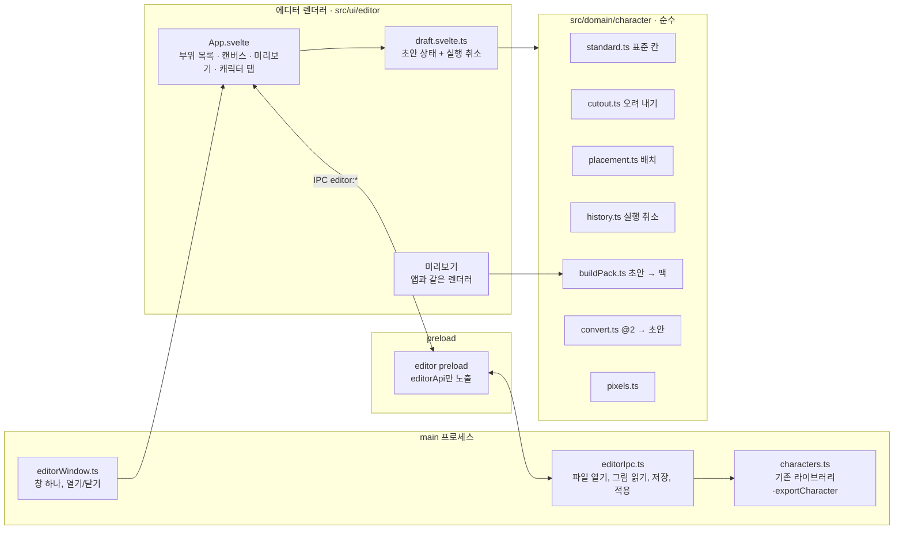

# 캐릭터 에디터 설계 (#26)

날짜: 2026-11-04 · 상태: 사용자 결정 반영, 계획 대기

## 왜 하는가

지금 커스텀 캐릭터를 만들려면 이렇게 해야 한다.

- 레이어 24장(`hair.back`, `eye.L.smile@turnL`…)을 Pixelorama나 Aseprite로 그린다.
- 팩 JSON에 영역, 표정, 상태를 직접 적는다.

무엇을 몇 장 그려야 하는지 알려 주는 곳이 없고, 결과는 내보낸 뒤에야 보인다. 사용자 말로는 "어떻게 그릴지 감도 안 온다".

사용자가 원하는 것은 **부위별로 그림을 불러오고, 캔버스에서 옮겨 배치하고, 조합해서** 캐릭터를 만드는 에디터다. 에디터는 **별도 창**에서 연다(사용자 결정).

## 목표

- **별도 창의 캐릭터 에디터.** 설정 › 캐릭터에서 "에디터 열기"를 누르면 연다. 화면은 세 부분이다.
  - 왼쪽: 부위 목록
  - 가운데: 확대 캔버스
  - 오른쪽: 실시간 미리보기
- **부위 칸.** 칸마다 정해진 레이어 이름으로 저장한다. 표정 변형이 있는 칸은 하위 칸을 둔다(눈: 뜬/감은, 입: 닫은/연).

  | 칸 | 레이어 | 필수 |
  | --- | --- | --- |
  | 뒷머리 | `hair.back` | |
  | 몸통 | `torso.chest`, `torso.belly` (한 장이면 `torso.chest`) | ✓ (몸 하나) |
  | 다리 | `leg.L`, `leg.R` | |
  | 팔 | `arm.L`, `arm.R` | |
  | 머리(얼굴) | `head` | |
  | 눈 | `eye.L.open`/`eye.L.closed`, `eye.R.*` (한 장이면 양쪽 묶음) | |
  | 입 | `mouth.closed`, `mouth.open` | |
  | 앞머리 | `hair.front` | |
  | 장식 | `custom.<이름>` (여러 개) | |

- **부위를 채우는 방법** (사용자 결정: 한 장 + 오려 내기가 먼저)
  1. **한 장을 불러와 오려 낸다.**
     - 캐릭터 그림 한 장(96×112 이하)을 불러온다.
     - 상자 선택이나 같은 색 영역 선택으로 부위를 골라 칸에 넣는다.
     - 오려 낸 부위는 원래 위치를 기억해서, 다시 배치할 필요가 없다.
     - 한 픽셀은 한 부위에만 속한다. 이미 오려 낸 픽셀은 원본에서 흐리게 표시한다.
  2. **레이어 파일을 통째로 불러온다**(.pxo, .aseprite, .psd). 레이어 이름을 칸에 맞추고, 맞지 않는 레이어는 사용자가 칸을 고른다.
  3. **칸마다 PNG를 불러온다.** 부위 하나만 바꿀 때 쓴다.
  4. **내장 캐릭터나 내 캐릭터의 같은 부위를 가져온다.** 예: lila의 몸 + moa의 머리. 이때 표준 칸으로 변환한다(아래 '표준 팩').
  5. 비워 둔다. 비운 부위는 그리지 않는다.
  - 모든 그림은 8비트 RGBA이고 96×112 이하다. 더 크면 "격자 정리"를 안내한다(pixel-art 스킬의 흐름).
- **배치**
  - 캔버스 96×112를 정수배(기본 4배)로 확대해서 보여 준다.
  - 부위를 끌어서 옮기면 1px 격자에 붙는다. 화살표키는 1px, Shift+화살표키는 8px씩 옮긴다.
  - 앞뒤 순서는 부위 목록에서 끌어서 바꾼다.
  - 안내선을 보여 준다: 발 위치(`feetY`), 머리 영역, 캔버스 경계.
  - 실행 취소와 다시 실행이 된다.
- **자동으로 정하는 것** (고급 설정 없이도 움직이게)
  - **누르는 영역(`hitAreas`):** 표준 이름(`baseCollision`)을 부위로 정한다.
    - `head` = 뒷머리, 머리, 눈, 입, 앞머리
    - `chest` = 몸통 위쪽
    - `belly` = 몸통 아래쪽
    - 팔과 다리는 `armL`/`armR`/`legL`/`legR`
  - **움직이는 영역(`regions`):** 부위의 외곽 상자로 정한다. `head`, `upper` 등 내장 팩과 같은 이름을 쓴다.
  - **표정:** 눈과 입 칸의 변형으로 만든다. 없으면 같은 그림을 쓴다.
  - **동작(`states`, `actions`):** 기본 템플릿 팩에서 가져온다. 대기, 깜빡임, 쓰다듬기, 끌림, 잠, 걷기 흔들림, 축하가 있다. 이 템플릿은 그림이 아니라 영역 이동이라 어떤 그림에도 맞는다.
    - **걷기**(사용자 결정)는 걷는 방향으로 그림을 **좌우 반전**하고 위아래로 흔든다. 렌더러에 수평 반전(`mirror` 상태 옵션)을 하나 더한다. 왼쪽을 볼 때 L/R 부위는 그림과 함께 뒤집힌다.
    - 누르는 영역은 내장 팩과 같은 세 개(`head`, `chest`, `belly`)에 반응을 단다. 팔과 다리 영역은 만들어 두되, 반응은 아직 달지 않는다.
- **캐릭터 탭**(사용자 결정: 에디터에서 입력)
  - 이름, 한 줄 성격(`persona`), 반응 대사를 입력한다. 대사는 쓰다듬기, 가슴 콕, 배 콕에 각각 여러 줄을 넣는다.
  - 비운 칸에는 중립 기본 대사를 쓴다.
- **실시간 미리보기**
  - 앱과 같은 렌더러(`src/renderer/character.ts`, `sprite.ts`)로 그린다.
  - 대기 → 깜빡임 → 쓰다듬기 → 걷기를 순서대로 돈다. 상태를 골라 볼 수도 있다.
  - 미리보기 위의 누르는 영역을 클릭하면 반응한다.
- **저장과 적용**
  - 결과는 지금 형식 그대로 내보낸다: 레이어 팩(`<id>.pxo`, `pack.json`)과 런타임(`character.json`, `sheet.png`).
  - 저장 위치는 `userData/characters/<id>/source`이고, 런타임 빌드는 기존 `exportCharacter`를 쓴다.
  - 그래서 앱이 그리는 방식은 바뀌지 않는다. 사용자는 나중에 Pixelorama로 열어 세밀하게 고칠 수 있다.
  - 저장하면 펫에 바로 적용할지 묻는다.
- **표준 팩** (사용자 결정: 개발 단계이니 지금 표준화한다)
  - 에디터 칸 구조를 **캐릭터 팩의 표준**으로 정한다(`format: study-pet-character@3`, 이하 "표준 팩").
  - 표준 팩은 정해진 칸과 레이어 이름, 템플릿에서 온 동작, 자동으로 만든 영역을 갖는다.
  - 표준이 아닌 팩(지금의 lila, moa, maru 같은 @2 팩)을 에디터로 열면 **표준 팩으로 변환**한다.
    - 칸에 맞는 레이어만 가져온다. 예: 홍채는 눈에, 신발은 다리에 합치고, 고개 돌린 그림과 걷기 그림은 뺀다.
    - 빠지는 것은 목록으로 미리 보여 주고, 원본은 그대로 두고 복제본을 만든다.
  - 에디터로 만든 팩을 Pixelorama로 고친 뒤 다시 열 때도 표준 칸에 맞춰 읽는다. 표준에 없는 레이어는 빠진다고 알린다.
  - 내장 캐릭터를 표준 팩으로 옮기는 일은 별도 이슈로 한다. 그 전까지 앱은 @2와 @3을 모두 읽는다.
- **새로 만들기와 열기**
  - "빈 캐릭터"로 시작하면 모든 칸이 비어 있고, 몸 칸만 필수다.
  - "기존 캐릭터에서 시작"을 고르면 위의 변환으로 표준 팩 복제본을 만든다. 내장 캐릭터 파일은 바꾸지 않는다.

## 하지 않는 것 (이번 범위)

- 픽셀 그리기 도구(붓, 지우개, 팔레트). 그리는 일은 Pixelorama, Aseprite나 다른 도구로 한다.
- 고개 돌린 버전(`@turnL`/`@turnR`)과 통째로 그린 자세(`poses`)의 편집. 고급 탭이 생기면 다룬다.
- 동작 타임라인 편집(프레임마다 영역 이동). 이번에는 템플릿을 그대로 쓴다.
- 색 꾸미기(#50에서 없앤다)와 옷 슬롯 편집.
- 멀티플레이 공유(#24)와 팩 zip 공유.

## 실패로 보는 것

- 에디터에서 만든 캐릭터가 앱 펫에서 다르게 보이는 것. 미리보기와 앱은 같은 렌더러를 써야 한다.
- 저장이 반쯤 끝난 상태로 남는 것. 기존 `characters.ts`처럼 검증한 뒤에 바꿔 넣는다.
- 부위를 옮기다 1px 어긋나는 것. 모든 좌표는 정수다.
- 내장 캐릭터 파일을 덮어쓰는 것.

## 제약

- 레이어 규칙
  - 에디터 화면 코드는 `src/ui/editor/`에 둔다(Svelte, 별도 렌더러 진입점).
  - 순수 규칙은 `src/domain/character-editor/`에 둔다. 부위에서 영역 만들기, 배치 좌표, 실행 취소 스택이 여기에 들어간다.
  - 창과 파일은 `src/main`(옛 폴더)이나 `src/infra`에 둔다.
- 창은 BrowserWindow 하나다(약 960×640, 크기 조절 가능, 일반 창). CSP와 preload는 펫 창과 같은 규칙이고, IPC는 에디터 전용 채널만 쓴다.
- 레이어 PNG 읽기와 쓰기는 기존 `scripts/character/png.mjs`, `pxo.mjs`(`readPxo`, `writePxo`)를 쓴다.
- 확인은 이렇게 한다.
  - 순수 규칙은 vitest로 테스트한다.
  - 에디터 창은 `check:ui`처럼 CDP로 누르는 검사를 둔다(`scripts/editor-check.mjs`).
    - 부위 불러오기, 옮기기, 저장, 펫 적용을 검사한다.
    - 임시 프로필과 임시 HOME에서 돌린다.

## 사용자가 정한 것

- 부위별 불러오기, 배치 이동, 조합이 되는 에디터를 만든다.
- 에디터는 별도 창이다.
- 그림은 **한 장을 불러와 오려 내는 방식**이 먼저다. 레이어 파일과 칸별 PNG도 지원한다.
- 지금은 개발 단계라 **표준을 정한다.** 에디터 칸 구조가 팩의 표준이고, 표준이 아닌 팩은 변환한다.
- 걷기는 좌우 반전과 흔들림으로 한다.
- 이름, 성격, 대사는 에디터에서 입력한다.
- 색 꾸미기는 없앤다(#50). 옷 갈아입기는 남긴다.

## 내가 정한 것 (확인 전)

- 부위 칸 목록과 레이어 이름: 위 표. 내장 팩과 같은 이름을 써서, 부위를 가져오고 앱에서 그리는 과정이 그대로 맞는다.
- 동작은 기본 템플릿 팩의 영역 이동으로 시작하고, 타임라인 편집은 나중에 한다.
- 최대 크기는 96×112(지금 캔버스)다. 더 큰 그림은 정리하도록 안내한다.
- 변환할 때 레이어 대응은 이렇다.
  - `iris.*`는 `eye.*`에 합친다.
  - `shade`, `blush`는 `head`에 합친다.
  - `neck`, `bottom`, `armfront.*`은 몸통에 합친다.
  - `shoe.*`는 다리에 합친다.
  - 기본 `mouth`는 `mouth.closed`, `talkA`는 `mouth.open`이 된다.
  - 옷 슬롯은 기본 변형만 장식 칸으로 가져온다.
- 템플릿 팩은 내장 팩의 `idle`, `patted`, `pouty`, `poked`, `dragged`(flail 자세 대신 흔들기), `sleep`, `celebrate`를 바탕으로 만든다.

## 빌더에게 맡기는 것

- 창 레이아웃의 세부, 부위 목록과 캔버스 컴포넌트 구성.
- 확대 배율 선택(2/4/6배).
- 실행 취소 깊이(예: 100).
- 템플릿 팩의 구체적인 상태 값(내장 팩의 `idle`, `patted` 등을 바탕으로).

## 구조

### 프로세스와 창

- **창:** `src/main/editorWindow.ts`가 BrowserWindow를 하나만 만든다. 이미 열려 있으면 앞으로 가져온다.
- **preload:** 에디터 전용 `src/preload/editor.ts`가 `editorApi`만 노출한다. 펫 창의 `petApi`와 섞지 않는다.
- **렌더러:** `src/ui/editor/`(Svelte)다. build.mjs의 세 번째 렌더러 진입점이고, 결과물은 `dist/editor/`다.
- **도메인(순수, 테스트 대상):** `src/domain/character/`
  - `pixels.ts`: `src/renderer/character/pixels.ts`를 옮긴다. 렌더러는 여기서 다시 내보낸다.
  - `standard.ts`: 표준 칸 목록과 초안 타입
  - `cutout.ts`: 상자 선택, 같은 색 영역 선택, 합치기와 빼기, 원래 좌표를 지키는 오려 내기
  - `placement.ts`: 1px 이동과 범위 제한, 앞뒤 순서
  - `history.ts`: 실행 취소와 다시 실행(불변 초안, 깊이 100)
  - `buildPack.ts`: 초안을 팩(@3)과 레이어 목록으로 바꾼다. 영역, 누르는 영역, 표정, 템플릿 동작(걷기 반전 포함)을 자동으로 만든다.
  - `convert.ts`: @2 팩의 레이어를 초안으로 바꾸고, 빠지는 목록을 함께 돌려준다.
- **main의 일:** `src/main/editorIpc.ts`
  - 파일 대화상자를 열고, 이미지와 레이어 파일을 RGBA로 읽는다(PNG는 `png.mjs`, .pxo는 `readPxo`, .aseprite는 CLI가 있을 때만).
  - 초안을 저장한다: `userData/characters/<id>/source`에 `<id>.pxo` + `pack.json`(@3)을 쓰고, 기존 `exportCharacter`로 런타임을 만든다. 실패하면 이전 것을 그대로 둔다.
  - 펫에 적용한다: 기존 캐릭터 전환 흐름을 쓴다.
  - .psd 읽기는 새 의존성이 필요해서 나중에 한다.

### 표준 팩 @3

- `format: 'study-pet-character@3'`이다. @2와 같은 구조에 다음을 더한다.
  - `editor: { version: 1 }` 표시
  - 상태 프레임의 `flip: boolean`(좌우 반전)
- 레이어 이름은 표준 칸 표의 이름만 쓴다.
- 검증(`characterImport.ts`, `check.mjs`)과 렌더러는 @2와 @3을 모두 받는다. 렌더러에서 새로 하는 일은 `flip` 하나다. 반전할 때 L/R 부위는 이름을 바꾸지 않고 그림과 함께 뒤집는다.

### 데이터 흐름

1. 불러오기: main이 그림을 RGBA로 읽고 IPC로 넘긴다. 오려 내기, 배치, 실행 취소는 모두 렌더러의 초안에서 일어난다.
2. 초안이 바뀔 때마다 `buildPack`이 미리보기용 팩과 시트를 메모리에서 만들고, 렌더러의 `setCharacter`로 그린다.
3. 저장: 초안을 IPC로 main에 보낸다. main은 .pxo와 pack.json을 쓰고 export한 뒤 결과를 알려 준다.

### 이슈 나누기 (순서와 병렬)

| 이슈 | 내용 | 선행 |
| --- | --- | --- |
| A | 표준 팩 도메인: pixels 이동, `standard.ts`, `buildPack.ts`, @3 검증과 렌더러 `flip` | 없음 |
| B | 변환기 `convert.ts`(lila, moa, maru로 테스트) | A |
| C | 에디터 창 뼈대: 창, preload, 진입점, IPC 골격, 세 칸 화면, 설정에서 열기, `editor-check` 검사 | 없음 (A와 병렬) |
| D | 그림 넣기: 한 장 + 오려 내기, 레이어 파일, 칸별 PNG, 다른 캐릭터 부위 | A, C |
| E | 캔버스: 확대, 1px 배치, 앞뒤 순서, 안내선, 실행 취소 | A, C (D와 병렬) |
| F | 미리보기, 캐릭터 탭, 저장과 적용 | A, C, (B) |
